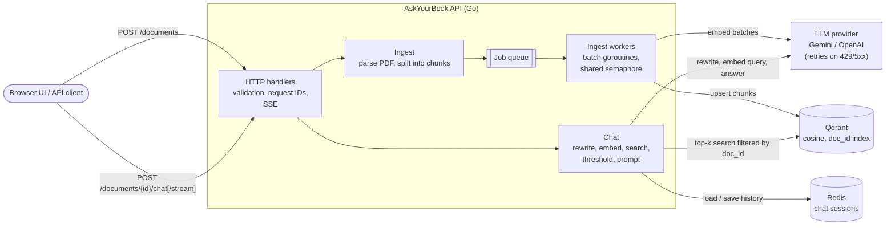

# AskYourBook

A "chat with your PDF" backend in Go. Upload a PDF; AskYourBook splits it into
chunks, embeds them concurrently and indexes them in **Qdrant**. Then ask questions
about it: each question is embedded with the same model, the most similar chunks are
retrieved by cosine similarity, and an LLM answers from those chunks only, citing
page numbers. Conversations are multi-turn, and follow-up questions are rewritten
into standalone queries before retrieval.

- **Browser chat UI** at `http://localhost:8080`: upload a PDF, then chat with
  streamed answers and clickable page citations
- **REST API** on the standard library (`net/http` with Go 1.22 routing), no web framework
- **Concurrent ingestion**: goroutines, a semaphore channel, a `WaitGroup` and
  context cancellation, written by hand
- **Qdrant** through a small hand-written REST client, so payloads and filters are fully controlled
- **LangChainGo** for PDF loading, text splitting, embeddings and chat;
  **Gemini** by default, **OpenAI** by configuration
- Async ingestion, SSE streaming, Redis-backed sessions, retries with backoff,
  structured logs with request IDs, Docker, CI

## Contents

- [Quick start](#quick-start)
- [Architecture](#architecture)
- [API reference](#api-reference)
- [Configuration](#configuration)
- [Design decisions](#design-decisions)
- [Development](#development)

## Quick start

You need Docker and a Gemini API key (or an OpenAI key; see
[Configuration](#configuration)).

```bash
cp .env.example .env          # then set GOOGLE_API_KEY
make stack                    # builds the API image and starts API + Qdrant + Redis
```

Or run the API on the host (Go 1.24.4+) with only the dependencies in Docker:

```bash
make up                       # Qdrant on :6333 (dashboard at /dashboard), Redis on :6379
make run                      # API on :8080, reads .env
```

Then open **http://localhost:8080** in your browser: click **Upload PDF** (or drag a
PDF onto the page), wait for it to show *Ready*, and start asking questions. Answers
stream in; click a page citation such as `p. 37` to see the passage it came from.
Follow-up questions keep the conversation's context; **New chat** starts over.

Or use the API directly:

```bash
# Upload: returns 202 at once; indexing continues in the background.
curl -F "file=@testdata/cpp_programming_guide.pdf" localhost:8080/documents
# {"chunks":100,"document_id":"<ID>","filename":"cpp_programming_guide.pdf","status":"processing"}

curl localhost:8080/documents/<ID>          # poll until "status":"ready" (a few seconds)

curl -X POST localhost:8080/documents/<ID>/chat \
  -H 'Content-Type: application/json' \
  -d '{"question":"What happens if a std::thread is destroyed without being joined?"}'
# {"session_id":"<SID>","answer":"... terminates the program (p. 37).","sources":[{"page":37,"score":0.76,...}]}

# A follow-up in the same session: rewritten to "Alternatives to std::thread ..."
curl -X POST localhost:8080/documents/<ID>/chat \
  -H 'Content-Type: application/json' \
  -d '{"session_id":"<SID>","question":"What should I use instead, and why?"}'
# {"answer":"You should prefer std::jthread instead (p. 37). ...","rewritten_query":"...",...}

# Stream the answer as Server-Sent Events
curl -N -X POST localhost:8080/documents/<ID>/chat/stream \
  -H 'Content-Type: application/json' -d '{"question":"Explain move semantics."}'
```

## Architecture



**Ingestion.** The upload handler parses the PDF and splits it into ~1000-character
chunks (150 overlap), each tagged with its 1-based page number. Unreadable or
text-less PDFs are rejected right there with a 4xx. The chunks are then queued, and the
request returns `202`. A background worker cuts them into batches and starts one
goroutine per batch; a service-wide semaphore channel caps how many embedding calls run
at once, a `WaitGroup` waits for them, and the first error cancels the rest through a
shared context. Each chunk is stored as a Qdrant point with payload
`{doc_id, filename, created_at, page, text}`. If any batch fails, the document's points
are deleted so it is never half-indexed.

**Chat.** For a follow-up question (the session has history), one LLM call rewrites it
into a standalone query ("what should I use instead?" becomes "alternatives to
std::thread ..."). The query is embedded with the same model used at ingestion, and
Qdrant returns the top-k chunks by cosine similarity, filtered to that document. Hits
below an optional score threshold are dropped; if none remain, the API answers "not
found" without calling the LLM. Otherwise the chunks are labelled `[Page N]` and sent to
the LLM with the conversation history and an instruction to answer only from them and
cite pages. History stores the user's original question and the answer, not the
retrieved context, so it stays small.

### Project layout

```
cmd/server/            wiring: config, LLM provider, Qdrant, sessions, graceful shutdown
internal/api/          HTTP handlers, validation, SSE, request-ID and access-log middleware
internal/web/          browser chat UI (HTML/CSS/JS embedded in the binary, served at /)
internal/rag/          ingestion (worker pool, concurrent embedding), chat, documents
internal/qdrant/       minimal Qdrant REST client
internal/session/      chat history stores: in-memory and Redis
internal/retry/        exponential backoff with jitter for LLM calls
internal/config/       environment configuration with defaults and validation
internal/logging/      slog setup; request ID on every log line
internal/ragtest/      in-memory fakes of the embedder, chat model and vector store
internal/integration/  integration tests against real Qdrant and Redis
testdata/              a 40-page C++ guide and a generated 6-page sample PDF
```

## API reference

All responses are JSON unless noted. Errors are `{"error": "..."}`. Every response
carries an `X-Request-ID` header (a valid incoming one is reused), which also appears on
every log line for that request.

| Method | Path | Description |
|---|---|---|
| `GET` | `/` | The browser chat UI |
| `GET` | `/health` | Liveness: `{"status":"ok"}` |
| `POST` | `/documents` | Upload a PDF (multipart field `file`) |
| `GET` | `/documents` | List documents, newest first |
| `GET` | `/documents/{id}` | One document and its status |
| `DELETE` | `/documents/{id}` | Delete a document and its chunks |
| `POST` | `/documents/{id}/chat` | Ask a question |
| `POST` | `/documents/{id}/chat/stream` | Ask a question; stream the answer (SSE) |

### `POST /documents`

Multipart form with a `file` field. Returns `202 Accepted` with a `Location` header:

```json
{"document_id": "8746...", "status": "processing", "filename": "guide.pdf", "chunks": 100}
```

| Status | When |
|---|---|
| 400 | Not a multipart form, no `file` field, or an empty file |
| 413 | Larger than `MAX_UPLOAD_MB` |
| 415 | Name doesn't end in `.pdf`, or content doesn't start with `%PDF-` |
| 422 | Unreadable PDF, or no extractable text (scanned PDFs need OCR) |
| 503 | Ingestion queue full or server shutting down (`Retry-After: 10`) |

### `GET /documents/{id}` and `GET /documents`

```json
{"id": "8746...", "filename": "guide.pdf", "chunks": 100,
 "created_at": "2026-10-25T11:50:34Z", "status": "ready"}
```

`status` is `processing`, `ready` or `failed` (with an `error` field). `GET /documents`
returns `{"documents": [...]}`. Unknown or malformed IDs return 404.

### `DELETE /documents/{id}`

`204 No Content`. Returns 409 while the document is still processing and 404 if it
doesn't exist.

### `POST /documents/{id}/chat`

```json
{"question": "What is RAII?", "session_id": "optional", "top_k": 4}
```

- `question`: required, at most 4000 characters.
- `session_id`: optional, at most 128 bytes. Omit it to start a conversation (one is
  generated and returned); send it back for follow-ups.
- `top_k`: optional. Omitted means `TOP_K_DEFAULT`; other values are clamped to
  `[1, TOP_K_MAX]`.

```json
{
  "session_id": "02227aef-...",
  "answer": "RAII ... is a central idiom of C++ ... (p. 17).",
  "sources": [{"page": 17, "score": 0.775, "snippet": "RAII: Resource Acquisition Is ..."}],
  "rewritten_query": "only present when a follow-up was rewritten"
}
```

| Status | When |
|---|---|
| 400 | Invalid JSON or field limits exceeded |
| 404 | Unknown document |
| 409 | Document is still processing, or its ingestion failed |

### `POST /documents/{id}/chat/stream`

Same request body. Responds with `text/event-stream`:

```
event: token
data: {"text":"Move semantics involve std::move, which ..."}

event: token
data: {"text":" ... (p. 34)."}

event: done
data: {"session_id":"...","sources":[...],"rewritten_query":"..."}
```

If generation fails midway, the last event is `event: error`. Errors before the first
token (400, 404, 409) are ordinary JSON responses with those status codes.

## Configuration

All settings come from environment variables (or `.env` with `make run` and
`make stack`). See [.env.example](.env.example).

| Variable | Default | Description |
|---|---|---|
| `LLM_PROVIDER` | `gemini` | `gemini` or `openai` |
| `GOOGLE_API_KEY` / `OPENAI_API_KEY` | | API key for the chosen provider |
| `CHAT_MODEL` | `gemini-2.5-flash` / `gpt-4o-mini` | Chat model |
| `EMBEDDING_MODEL` | `gemini-embedding-001` / `text-embedding-3-small` | Embedding model |
| `EMBEDDING_DIM` | `3072` / `1536` | Vector size; required if `EMBEDDING_MODEL` is overridden |
| `PORT` | `8080` | HTTP port |
| `QDRANT_URL` | `http://localhost:6333` | Qdrant REST endpoint |
| `QDRANT_COLLECTION` | `askyourbook_<provider>` | Collection name |
| `CHUNK_SIZE` / `CHUNK_OVERLAP` | `1000` / `150` | Chunking, in characters |
| `EMBED_WORKERS` | `4` | Max concurrent embedding calls, across all uploads |
| `EMBED_BATCH_SIZE` | `32` | Chunks per embedding call |
| `INGEST_WORKERS` | `2` | Documents indexed concurrently |
| `INGEST_QUEUE` | `16` | Uploads that can wait for a worker; beyond this, 503 |
| `MAX_UPLOAD_MB` | `50` | Upload size limit |
| `TOP_K_DEFAULT` / `TOP_K_MAX` | `4` / `20` | Chunks retrieved per question |
| `SCORE_THRESHOLD` | `0` (off) | Minimum cosine similarity for a chunk to be used |
| `REWRITE_QUERIES` | `true` | Rewrite follow-ups into standalone queries |
| `HISTORY_MESSAGES` | `10` | Messages kept per session |
| `SESSION_STORE` | `memory` | `memory` or `redis` (`make stack` uses Redis) |
| `REDIS_URL` | `redis://localhost:6379/0` | Redis for sessions |
| `SESSION_TTL` | `24h` | Idle sessions are forgotten after this |
| `LLM_MAX_RETRIES` | `4` | Retries after the first attempt on 429/5xx/network errors |
| `LLM_RETRY_BASE_DELAY` / `LLM_RETRY_MAX_DELAY` | `500ms` / `10s` | Backoff bounds |
| `LOG_FORMAT` / `LOG_LEVEL` | `text` / `info` | `text` or `json`; `debug` to `error` |

## Design decisions

**A hand-written Qdrant client instead of a LangChainGo vector store.** The client is
about 200 lines and gives full control over the payload (page numbers, `created_at`),
the `doc_id` filter on every query, the keyword index, exact counts, facets for listing,
and filtered deletes. Search uses `/points/query`, which replaces the deprecated
`/points/search`. At startup, `EnsureCollection` creates the collection only on a 404
and refuses to start if an existing collection's vector size doesn't match the
embedding model.

**Hand-rolled concurrency.** Each batch runs in its own goroutine and must take a slot
from a semaphore channel before calling the provider. The semaphore is shared by all
uploads, so `EMBED_WORKERS` caps total in-flight provider calls, not calls per upload.
The first error cancels a shared context. A test on the 100-chunk sample checks that
peak concurrency equals the limit exactly, and that a failure stops the remaining
batches. That test caught a real bug: Go's `select` picks randomly among ready cases,
so a goroutine could take a freed slot *after* cancellation and still call the
provider. The slot holder now re-checks the context.

**Parse in the request, embed in the background.** Parsing a PDF is fast and local,
so the upload request does it and rejects bad files with a precise 4xx. Embedding is
slow and remote, so it runs on a worker pool with a bounded queue. No temporary file is
needed, because the queued job carries the extracted chunks rather than the PDF.
Shutdown drains the queue, then cancels and cleans up whatever is still running.

**Documents live in Qdrant.** A ready document is defined by its chunks: lookups read
one point plus an exact count, and listing uses Qdrant's facet API on `doc_id`. Only
the `processing` and `failed` statuses are held in memory. A restart therefore loses
no documents, and there is no second store to keep consistent.

**Query rewriting.** In a test on the C++ guide, "What should I use instead?" after a
question about `std::thread`, embedded as-is, retrieved pages about containers
(top score 0.61), and the grounded LLM correctly said it couldn't find the answer. After
rewriting, the query retrieves page 37 (0.74), and the answer is `std::jthread` with
both reasons. The cost is one extra LLM call per follow-up, about 1.5–3.5 s with
Gemini 2.5 Flash, whose built-in "thinking" can't be turned off through LangChainGo.
`REWRITE_QUERIES=false` disables it.

**Score threshold off by default.** Gemini similarity scores sit close together. On
the C++ guide, 12 relevant questions scored 0.60–0.77 and 10 unrelated ones 0.46–0.62,
so the ranges overlap: a programming question about Rust outscored two genuine ones.
`SCORE_THRESHOLD=0.55` rejects clearly off-topic questions (geography, sport, cooking)
without losing any relevant answers in that test. The grounded prompt handles the rest.

**Retries that are safe to stream.** Embedding and chat calls retry HTTP 429, 5xx and
network errors with exponential backoff and full jitter, and never retry cancellation.
A streamed answer is retried only before its first chunk reaches the client, so a retry
never repeats text the client already has.

**Streaming status codes.** The SSE response starts with the first token, so
validation, 404 and 409 errors still return proper status codes. A client disconnect
cancels the LLM call, and an interrupted turn is not saved to history.

**Sessions behind an interface.** `memory` is fine for one instance; it now expires
idle sessions instead of growing forever. `redis` stores each session as a capped list
(`RPUSH` + `LTRIM` + `EXPIRE` in one `MULTI`), so history survives restarts and is
shared across replicas.

**A UI with no frontend toolchain.** The chat page is plain HTML, CSS and JavaScript
embedded in the Go binary with `go:embed` and served from the same origin as the API,
so there's no Node build, no CORS, and the Docker image ships it automatically. It
reads the SSE stream with `fetch` (EventSource can't POST), renders a small Markdown
subset after escaping all text (document content can't inject HTML), and is served
with a strict Content-Security-Policy that allows no inline scripts. Each document's
conversation is kept in `localStorage`, so a refresh doesn't lose it.

### Known limitations

- Scanned PDFs need OCR; they are rejected with 422.
- Processing and failed statuses are in memory: if the server is killed mid-ingest,
  that upload is lost, though its partial chunks are cleaned up on graceful shutdown.
- With Gemini, the first streamed token takes a few seconds (the model thinks first),
  and text arrives in a few large chunks rather than word by word.
- Deleting a document doesn't delete its chat sessions; they expire with `SESSION_TTL`.

## Development

```bash
make test               # unit tests with the race detector (no network, no API key)
make lint               # gofmt + go vet
make up                 # Qdrant + Redis for the integration tests
TEST_REDIS_URL=redis://localhost:6379/15 make test-integration
```

- **Unit tests** run the real handlers and service on in-memory fakes
  (`internal/ragtest`). They cover validation and status codes, SSE output, top-k
  clamping, ingest batching and concurrency limits, cancellation on first error, async
  status, shutdown, query rewriting, the score threshold, retry classification
  (including the real Gemini client over a fake transport), and the Qdrant client
  against `httptest.Server`.
- **Integration tests** (`-tags integration`) run against real Qdrant and Redis with a
  deterministic bag-of-words embedder, so they need no API key. They check that the
  right page is retrieved for each question, that sessions persist, and that deletes
  work.
- **CI** (GitHub Actions) runs gofmt, `go vet` and `staticcheck`; unit tests on Go
  1.24.4 and 1.26.9; the integration tests against Qdrant and Redis service containers;
  and the Docker build.

If another Redis already listens on port 6379 (for example, Homebrew), start the compose
one elsewhere: `REDIS_PORT=6380 make up`, then use `redis://localhost:6380/...`.
