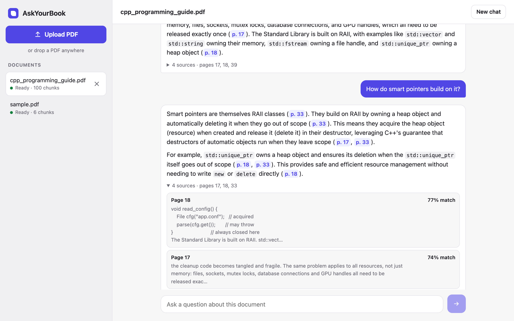

# AskYourBook

[](https://github.com/ayanshakil/askyourbook/actions/workflows/ci.yml)
[](go.mod)
[](LICENSE)

**Chat with your PDFs.** Upload a PDF, ask questions about it, and get answers drawn
only from the document, with clickable page citations. AskYourBook is a
Retrieval-Augmented Generation (RAG) backend written in Go, with a small built-in web UI.



## Features

- **Grounded answers with citations.** Every answer comes from the retrieved passages
  and cites its pages; click a citation to see the passage it came from.
- **Multi-turn chat.** Follow-ups like *"what should I use instead?"* are rewritten into
  standalone search queries using the conversation, so retrieval still finds the right
  pages.
- **Concurrent ingestion.** PDFs are split into overlapping chunks and embedded in
  parallel batches by goroutines bounded by a semaphore channel, with fail-fast
  cancellation, then indexed in **Qdrant**.
- **Semantic search.** Questions are embedded with the same model as the documents,
  and the top-k chunks are retrieved by cosine similarity, filtered to the document.
- **Streaming.** Answers stream token by token over Server-Sent Events.
- **Production touches.** Async ingestion with a bounded worker queue, retries with
  exponential backoff and jitter, Redis-backed sessions, structured logs with request
  IDs, graceful shutdown, Docker, and CI.

## Tech stack

| | |
|---|---|
| Language | Go 1.24+, standard library `net/http` (no web framework) |
| LLM framework | [LangChainGo](https://github.com/tmc/langchaingo): PDF loading, text splitting, embeddings, chat |
| Models | Google Gemini (`gemini-2.5-flash`, `gemini-embedding-001`) or OpenAI (`gpt-4o-mini`, `text-embedding-3-small`), chosen by which API key you provide |
| Vector database | [Qdrant](https://qdrant.tech), through a small hand-written REST client |
| Sessions | In-memory or Redis |
| UI | Plain HTML, CSS and JavaScript, embedded in the binary |
| Tooling | Docker Compose, GitHub Actions, staticcheck |

## Quick start

**You need:** Docker (with Compose v2.24 or newer) and an API key from either
**Google Gemini** ([free key](https://aistudio.google.com/apikey)) or **OpenAI**
([key](https://platform.openai.com/api-keys)). To run the API outside Docker you also
need Go 1.24 or newer.

```bash
git clone https://github.com/ayanshakil/askyourbook.git
cd askyourbook
cp .env.example .env
```

Open `.env` and fill in **one** key. AskYourBook picks the provider from whichever key
is present:

```bash
GOOGLE_API_KEY=your-gemini-key        # Gemini (GEMINI_API_KEY works too)
# or
OPENAI_API_KEY=your-openai-key        # OpenAI
```

**Option A: everything in Docker**

```bash
make stack                    # builds the API image, starts API + Qdrant + Redis
```

**Option B: the API on your machine, Qdrant and Redis in Docker** (handy while
changing code)

```bash
make up                       # Qdrant and Redis
make run                      # the API
```

Then open **http://localhost:8080**. Click **Upload PDF** (or drop a PDF onto the
page), wait a few seconds for it to show *Ready*, and ask a question. Two PDFs to try
are in [`testdata/`](testdata): a 40-page C++ guide and a short sample document.

`make help` lists every command. `make down` stops the containers.

### Using the API directly

The UI is a client of a plain JSON API, which you can call yourself:

```bash
# Upload: returns 202 at once; indexing continues in the background.
curl -F "file=@testdata/cpp_programming_guide.pdf" localhost:8080/documents
# {"chunks":100,"document_id":"<ID>","filename":"cpp_programming_guide.pdf","status":"processing"}

curl localhost:8080/documents/<ID>          # poll until "status":"ready" (a few seconds)

curl -X POST localhost:8080/documents/<ID>/chat \
  -H 'Content-Type: application/json' \
  -d '{"question":"What happens if a std::thread is destroyed without being joined?"}'
# {"session_id":"<SID>","answer":"... terminates the program (p. 37).","sources":[{"page":37,"score":0.76,...}]}

# A follow-up in the same session; it is rewritten to "Alternatives to std::thread ..."
curl -X POST localhost:8080/documents/<ID>/chat \
  -H 'Content-Type: application/json' \
  -d '{"session_id":"<SID>","question":"What should I use instead, and why?"}'
# {"answer":"You should prefer std::jthread instead (p. 37). ...","rewritten_query":"...",...}

# Stream the answer as Server-Sent Events
curl -N -X POST localhost:8080/documents/<ID>/chat/stream \
  -H 'Content-Type: application/json' -d '{"question":"Explain move semantics."}'
```

## How it works


**Ingestion.** The upload handler parses the PDF and splits it into ~1000-character
chunks with 150 characters of overlap, each tagged with its 1-based page number.
Unreadable, text-less or oversized PDFs are rejected right away with a 4xx. Otherwise
the chunks are queued and the request returns `202 Accepted`. A background worker cuts
them into batches and starts one goroutine per batch. A semaphore channel shared by all
uploads caps how many embedding calls run at once, a `WaitGroup` waits for them, and the
first error cancels the rest through a shared context. Each chunk becomes a Qdrant point
with the payload `{doc_id, filename, created_at, total_chunks, page, text}`. If
indexing fails, the chunks already stored are deleted.

**Chat.** If the session has history, one LLM call first rewrites the question into a
standalone query ("what should I use instead?" becomes "alternatives to std::thread
..."). The query is embedded with the same model used for the documents, and Qdrant
returns the top-k chunks by cosine similarity, filtered to that document. Chunks below
an optional score threshold are dropped; if none remain, the API answers "not found"
without calling the LLM. Otherwise the chunks are labelled `[Page N]` and sent to the LLM
with the conversation history and an instruction to answer only from them and to cite
pages. The history stores the user's original question and the answer, not the
retrieved passages, so it stays small.

### Project layout

```
cmd/server/            entry point: config, LLM provider, Qdrant, sessions, graceful shutdown
internal/api/          HTTP handlers, validation, SSE, middleware (request IDs, access log, CSRF guard)
internal/web/          the browser UI (HTML/CSS/JS embedded in the binary, served at /)
internal/rag/          ingestion (worker pool, concurrent embedding), chat, documents
internal/qdrant/       minimal Qdrant REST client
internal/session/      chat history stores: in-memory and Redis
internal/retry/        exponential backoff with jitter for LLM calls
internal/config/       configuration from environment variables, with defaults and validation
internal/logging/      slog setup; request ID on every log line
internal/ragtest/      in-memory fakes of the embedder, chat model and vector store, for tests
internal/integration/  integration tests against real Qdrant and Redis
testdata/              sample PDFs
```

## API reference

Responses are JSON unless noted, and errors look like `{"error": "..."}`. Every
response carries an `X-Request-ID` header (a valid incoming one is reused), which also
appears on every log line for that request.

| Method | Path | Description |
|---|---|---|
| `GET` | `/` | The web UI |
| `GET` | `/health` | Liveness check: `{"status":"ok"}` |
| `POST` | `/documents` | Upload a PDF (multipart field `file`) |
| `GET` | `/documents` | List documents, newest first |
| `GET` | `/documents/{id}` | One document and its status |
| `DELETE` | `/documents/{id}` | Delete a document and its chunks |
| `POST` | `/documents/{id}/chat` | Ask a question |
| `POST` | `/documents/{id}/chat/stream` | Ask a question and stream the answer (SSE) |

POST and DELETE requests that a browser marks as coming from another website are
rejected with `403`, so other sites can't use your local instance. Tools such as curl
are unaffected.

### `POST /documents`

A multipart form with a `file` field. Returns `202 Accepted` and a `Location` header:

```json
{"document_id": "8746...", "status": "processing", "filename": "guide.pdf", "chunks": 100}
```

| Status | When |
|---|---|
| 400 | Not a multipart form, no `file` field, or an empty file |
| 413 | Larger than `MAX_UPLOAD_MB`, or more than `MAX_CHUNKS` chunks of text |
| 415 | The name doesn't end in `.pdf`, or the content doesn't start with `%PDF-` |
| 422 | An unreadable PDF, or one with no extractable text (scanned PDFs need OCR) |
| 503 | The ingestion queue is full or the server is shutting down (`Retry-After: 10`) |

### `GET /documents/{id}` and `GET /documents`

```json
{"id": "8746...", "filename": "guide.pdf", "chunks": 100,
 "created_at": "2026-10-25T11:50:34Z", "status": "ready"}
```

`status` is `processing`, `ready` or `failed`; a failed document also has an `error`
field. `GET /documents` returns `{"documents": [...]}`. Unknown IDs return `404`.

### `DELETE /documents/{id}`

Returns `204 No Content`, `409` while the document is still processing, or `404`.

### `POST /documents/{id}/chat`

```json
{"question": "What is RAII?", "session_id": "optional", "top_k": 4}
```

- `question`: required, at most 4000 characters.
- `session_id`: optional, at most 128 bytes. Leave it out to start a new conversation
  (an ID is generated and returned); send it back for follow-up questions.
- `top_k`: optional. Defaults to `TOP_K_DEFAULT`; other values are clamped to
  `[1, TOP_K_MAX]`.

```json
{
  "session_id": "02227aef-...",
  "answer": "RAII ... is a central idiom of C++ ... (p. 17).",
  "sources": [{"page": 17, "score": 0.775, "snippet": "RAII: Resource Acquisition Is ..."}],
  "rewritten_query": "present only when a follow-up was rewritten"
}
```

| Status | When |
|---|---|
| 400 | Invalid JSON, or a field over its limit |
| 404 | Unknown document |
| 409 | The document is still processing, or its ingestion failed |
| 502 | The model returned an empty answer (for example, a safety block) |

### `POST /documents/{id}/chat/stream`

The same request body. The response is `text/event-stream`:

```
event: token
data: {"text":"Move semantics involve std::move, which ..."}

event: token
data: {"text":" ... (p. 34)."}

event: done
data: {"session_id":"...","sources":[...],"rewritten_query":"..."}
```

If generation fails partway through, the last event is `event: error`. Errors that
happen before the first token (400, 404, 409, 502) are ordinary JSON responses with
those status codes.

## Configuration

Settings come from environment variables; `make run` and `make stack` read them from
`.env`. See [`.env.example`](.env.example) for a commented template.

| Variable | Default | Description |
|---|---|---|
| `GOOGLE_API_KEY` (or `GEMINI_API_KEY`) | | Gemini API key |
| `OPENAI_API_KEY` | | OpenAI API key |
| `LLM_PROVIDER` | chosen from the key | `gemini` or `openai`. Unset: whichever key is present (Gemini if both) |
| `CHAT_MODEL` | `gemini-2.5-flash` / `gpt-4o-mini` | Chat model |
| `EMBEDDING_MODEL` | `gemini-embedding-001` / `text-embedding-3-small` | Embedding model |
| `EMBEDDING_DIM` | `3072` / `1536` | Vector size; required if `EMBEDDING_MODEL` is changed |
| `PORT` | `8080` | HTTP port |
| `QDRANT_URL` | `http://localhost:6333` | Qdrant REST endpoint |
| `QDRANT_COLLECTION` | `askyourbook_<provider>` | Collection name |
| `CHUNK_SIZE` / `CHUNK_OVERLAP` | `1000` / `150` | Chunking, in characters |
| `EMBED_WORKERS` | `4` | Most embedding calls in flight at once, across all uploads |
| `EMBED_BATCH_SIZE` | `32` | Chunks per embedding call |
| `INGEST_WORKERS` | `2` | Documents indexed at the same time |
| `INGEST_QUEUE` | `16` | Uploads that can wait for a worker; beyond this, `503` |
| `MAX_UPLOAD_MB` | `50` | Upload size limit |
| `MAX_CHUNKS` | `2000` | Larger documents (about 800 pages) are rejected |
| `TOP_K_DEFAULT` / `TOP_K_MAX` | `4` / `20` | Chunks retrieved per question |
| `SCORE_THRESHOLD` | `0` (off) | Minimum cosine similarity for a chunk to be used |
| `REWRITE_QUERIES` | `true` | Rewrite follow-up questions into standalone queries |
| `HISTORY_MESSAGES` | `10` | Messages kept per conversation |
| `SESSION_STORE` | `memory` | `memory` or `redis` (`make stack` uses Redis) |
| `REDIS_URL` | `redis://localhost:6379/0` | Redis address for sessions |
| `SESSION_TTL` | `24h` | Idle conversations are forgotten after this |
| `LLM_MAX_RETRIES` | `4` | Retries on 429, 5xx and network errors |
| `LLM_RETRY_BASE_DELAY` / `LLM_RETRY_MAX_DELAY` | `500ms` / `10s` | Backoff bounds |
| `LOG_FORMAT` / `LOG_LEVEL` | `text` / `info` | `text` or `json`; `debug`, `info`, `warn` or `error` |

### Gemini or OpenAI

Either provider runs the whole pipeline: embedding the PDF chunks, embedding questions,
rewriting follow-ups and writing answers. One provider is used at a time, because a
question must be embedded by the same model as the document it is searched against.

| | Gemini | OpenAI |
|---|---|---|
| Chat model | `gemini-2.5-flash` | `gpt-4o-mini` |
| Embedding model | `gemini-embedding-001` (3072 dimensions) | `text-embedding-3-small` (1536 dimensions) |
| Qdrant collection | `askyourbook_gemini` | `askyourbook_openai` |

Each provider gets its own Qdrant collection, since their embeddings aren't comparable.
Switching providers therefore shows a separate document list: upload your PDFs again
after switching. `CHAT_MODEL`, `EMBEDDING_MODEL` and `EMBEDDING_DIM` override the models.

## Design decisions

**A hand-written Qdrant client instead of a LangChainGo vector store.** About 200 lines
of Go give full control over the payload (page numbers, `created_at`, `total_chunks`),
the `doc_id` filter on every query, the keyword index, exact counts, facets for listing,
and filtered deletes. Search uses `/points/query`, which replaces the deprecated
`/points/search`. At startup the client creates the collection only if it's missing,
and refuses to start if an existing collection's vector size doesn't match the
embedding model.

**Hand-rolled concurrency.** Each batch runs in its own goroutine and must take a slot
from a semaphore channel before calling the embedding API. Because the semaphore is
shared by all uploads, `EMBED_WORKERS` limits the total load on the provider, not the
load per upload. The first error cancels a shared context. A test on the 100-chunk C++
guide checks that peak concurrency equals the limit exactly and that a failure stops
the remaining batches. That test caught a subtle bug: Go's `select` picks randomly among
ready cases, so a goroutine could take a freed slot *after* cancellation and still call
the API. The code re-checks the context after acquiring a slot.

**Parse in the request, embed in the background.** Parsing a PDF is fast and local, so
the upload request does it and can reject a bad file with a precise status code.
Embedding is slow and remote, so it runs on a worker pool with a bounded queue. The
queued job carries the extracted chunks rather than the PDF, so no temporary files are
needed. Shutdown lets queued work finish, then cancels and cleans up whatever is still
running.

**Documents live in Qdrant.** A ready document is defined by its stored chunks: a lookup
reads one point plus an exact count, and the list uses Qdrant's facet API on `doc_id`.
Only the `processing` and `failed` states are kept in memory, so restarting the server
loses no documents and there is no second database to keep in sync. Every chunk also
records `total_chunks`, so a document whose ingestion was interrupted (for example, by a
crash) shows up as *failed (incomplete)* rather than as a ready document with pages
missing.

**Query rewriting.** In a test on the C++ guide, *"What should I use instead?"* asked
after a question about `std::thread`, embedded as-is, retrieved pages about containers
(top score 0.61), and the LLM correctly said it couldn't find the answer. Rewritten
using the conversation, the query retrieves page 37 (0.74) and the answer is
`std::jthread`, with both reasons. The cost is one extra LLM call per follow-up, about
1.5–3.5 s with Gemini 2.5 Flash. `REWRITE_QUERIES=false` turns it off.

**Score threshold off by default.** Gemini's similarity scores sit close together. On
the C++ guide, 12 relevant questions scored 0.60–0.77 and 10 unrelated ones 0.46–0.62;
the ranges overlap, and a question about Rust outscored two genuine ones. Setting
`SCORE_THRESHOLD=0.55` rejects clearly off-topic questions (geography, sport, cooking)
without losing any relevant answers in that test; the grounded prompt handles the rest.

**Retries that are safe to stream.** Embedding and chat calls retry HTTP 429, 5xx and
network errors with exponential backoff and full jitter, and never retry a cancelled
request. A streamed answer is retried only before its first chunk reaches the client, so
a retry never repeats text the client already has.

**Streaming with real status codes.** The SSE response starts with the first token, so
validation errors, 404, 409 and 502 still arrive as proper HTTP status codes. If the
client disconnects, the LLM call is cancelled and the unfinished turn isn't saved.

**Sessions behind an interface.** The `memory` store suits a single instance; it expires
idle conversations and holds at most 10,000 of them. The `redis` store keeps each
conversation as a capped list (`RPUSH` + `LTRIM` + `EXPIRE` in one `MULTI`), so history
survives restarts and can be shared by several instances.

**A web UI with no frontend toolchain.** The UI is plain HTML, CSS and JavaScript,
embedded in the binary with `go:embed` and served from the same origin as the API: no
Node build, no CORS, and the Docker image includes it automatically. It reads the SSE
stream with `fetch`, since `EventSource` can't send a POST. Answers are rendered by a
small Markdown renderer that escapes all text first, so document content can't inject
HTML, and the page is served with a strict Content-Security-Policy that allows no inline
scripts.

**Safe defaults for a local tool.** There is no login, so the API refuses cross-site
requests from browsers, Docker Compose publishes every port on `127.0.0.1` only, and
5xx responses return a generic message while the details go to the log.

### Limitations

- Scanned PDFs need OCR; they are rejected with `422`.
- There is no authentication or per-user isolation: anyone who can reach the server
  can see every document. Treat it as a single-user tool.
- One API instance at a time: the *processing* and *failed* states live in that
  instance's memory.
- With Gemini, the first streamed token takes a few seconds (the model "thinks"
  first), and text arrives in a few large pieces rather than word by word.
- Deleting a document doesn't delete its conversations; they expire after
  `SESSION_TTL`.

## Development

```bash
make test               # unit tests with the race detector (no network or API key)
make lint               # gofmt and go vet
make up                 # Qdrant and Redis, for the integration tests
TEST_REDIS_URL=redis://localhost:6379/15 make test-integration
```

- **Unit tests** run the real HTTP handlers and service against in-memory fakes
  (`internal/ragtest`). They cover input validation and status codes, the SSE format,
  top-k clamping, batching and concurrency limits, cancellation on the first error,
  async status and shutdown, partial and empty results, query rewriting, the score
  threshold, the cross-site guard, retry classification (including the real Gemini
  client over a fake transport), the Qdrant client against `httptest.Server`, and both
  session stores.
- **Integration tests** (`-tags integration`) run against real Qdrant and Redis with a
  deterministic bag-of-words embedder, so they need no API key. They check that the
  right page is retrieved for each question, that conversations persist, and that
  deletes work.
- **CI** (GitHub Actions) runs gofmt, `go vet` and `staticcheck`, the unit tests on Go
  1.24 and 1.26, the integration tests against Qdrant and Redis service containers, and
  the Docker build.

### Troubleshooting

| Problem | Fix |
|---|---|
| `make up` fails: port 6379 is in use (for example, by a Homebrew Redis) | `REDIS_PORT=6380 make up`, and set `REDIS_URL=redis://localhost:6380/0` if you use Redis sessions |
| `address already in use` on port 8080 | `PORT=8081 make run` (or `API_PORT=8081 make stack`) |
| `qdrant: ... connection refused` at startup | Start Qdrant with `make up` |
| Chat returns `409` | The document is still being indexed; wait a few seconds |
| `no LLM API key found` at startup | Put `GOOGLE_API_KEY=...` or `OPENAI_API_KEY=...` in `.env` (no spaces around `=`) |
| Documents disappeared after changing the key | Each provider has its own collection; switch back, or upload them again |
| Upload shows *Failed*, or chat returns `500` | Check the server log; it is usually an invalid or rate-limited API key |

## License

[MIT](LICENSE)
